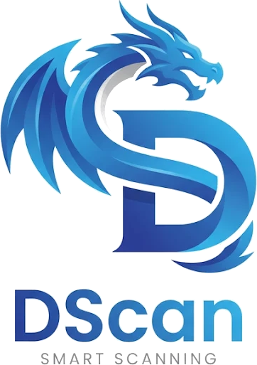
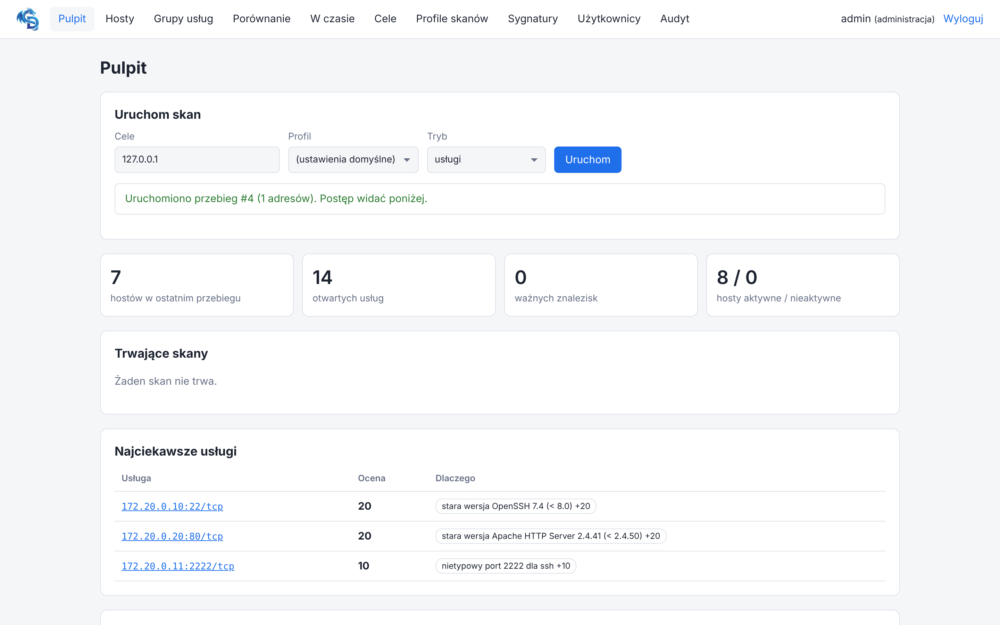
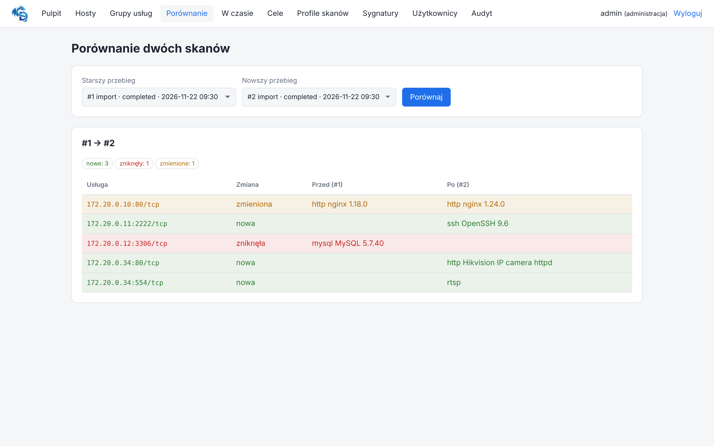
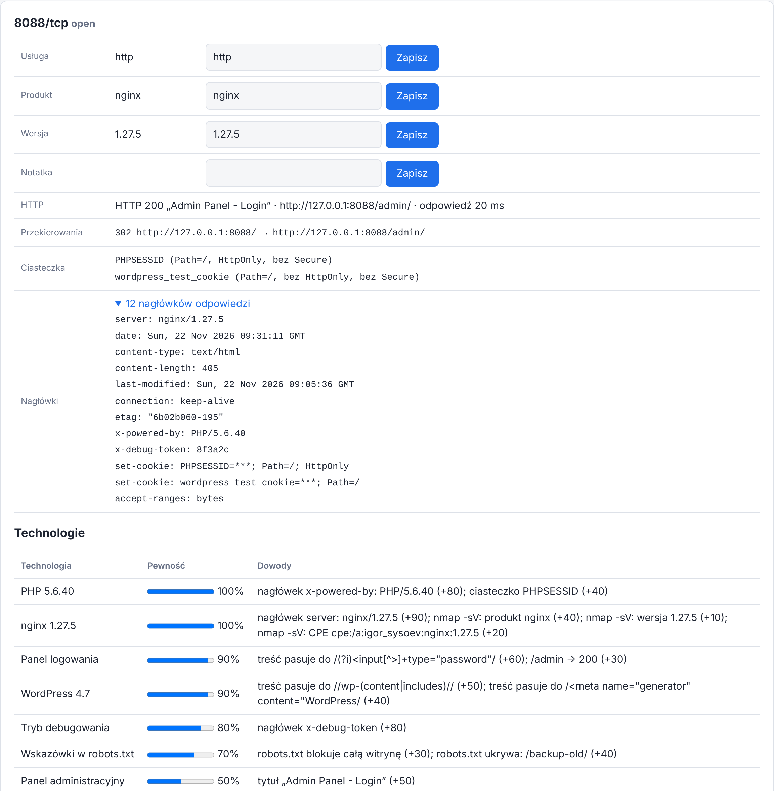
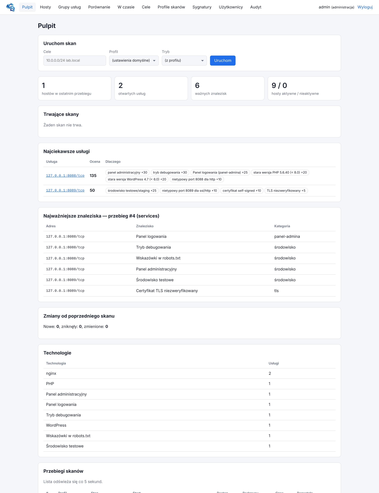
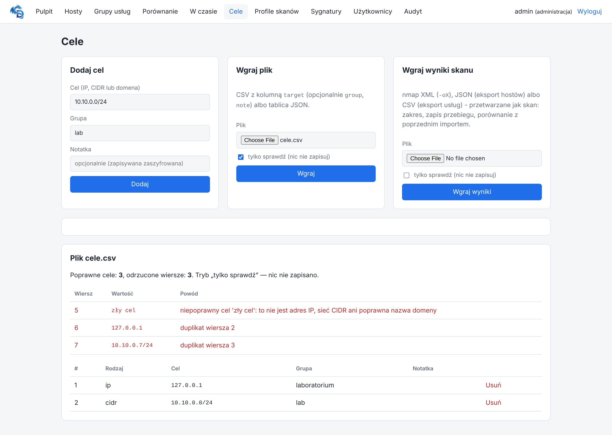
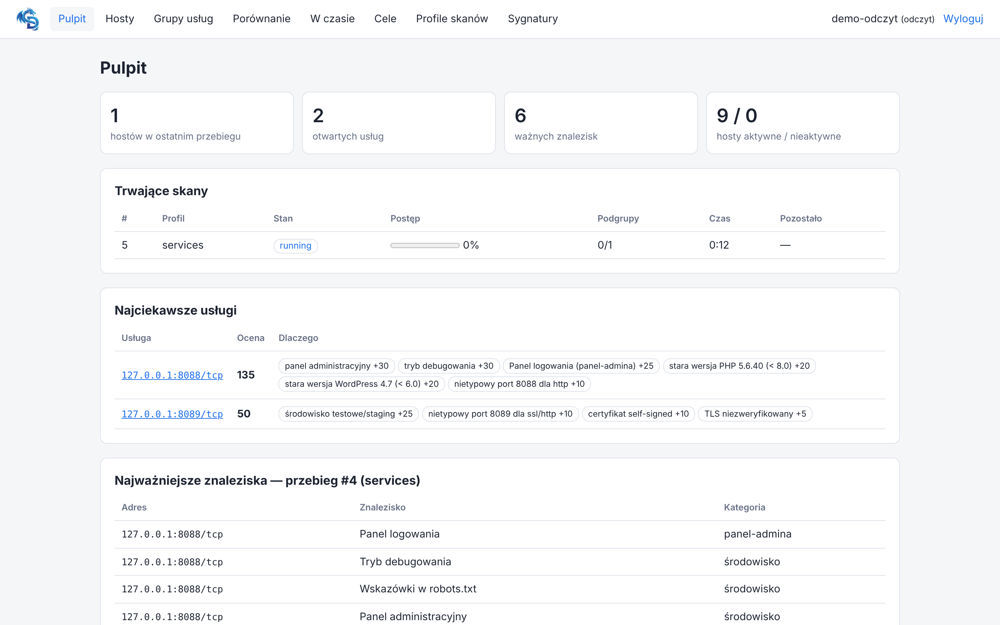

# DScan - Defect Scan

Inwentaryzacja usług sieciowych z wykrywaniem zmian

- jedna binarka w Ruście: serwer WWW + API + CLI, PostgreSQL
- instalacja i start: `./install.sh`, kolejne uruchomienia: `./run.sh`

---

## Problem i rozwiązanie

- Co działa w dużej sieci, w jakiej wersji i **co się zmieniło** od ostatniego skanu?
- Skan nmap w podgrupach CIDR z limitem tempa, tylko dozwolone sieci i porty, okna czasowe
- Fingerprinting HTTP/HTTPS, ok. 50 sygnatur + własne, ranking najciekawszych usług
- Porównanie przebiegów, edycja wyników, 4 role, szyfrowanie danych, DefectDojo

---

## Skan z panelu WWW

- cel, profil i tryb w formularzu; postęp, czas i prognoza na żywo
- 16 384 adresów w 64 podgrupach - test z panelu

---

## Wykrywanie zmian

- usługi nowe / zniknięte / zmienione między dowolnymi przebiegami

---

## Fingerprinting HTTP/HTTPS

- tytuł, kod, przekierowania, ciasteczka, nagłówki, certyfikat; technologie z pewnością i dowodami

---

## Najważniejsze znaleziska

- ranking „ciekawości” z uzasadnieniem: panel, debug, stare wersje, staging, TLS

---

## Edycja, import, eksport

- edycja wyniku przetrwa kolejne skany; import celów i wyników (XML, JSON, CSV), eksport CSV/JSON

---

## Role i audyt

- 4 role + własne; „odczyt” bez formularzy zmian, każda zmiana w dzienniku audytu

---

## Bezpieczeństwo i jakość

- tylko `nmap -sn/-sV`, bez NSE i logowania; zakres i porty wymuszone w kodzie; HTTP tylko GET
- AES-256-GCM dla danych poufnych, rotacja kluczy, hasła argon2id, wartości ciasteczek ukryte
- laboratorium: 31/31 portów, 100% precyzji i czułości, 0 fałszywych zmian
- CI: fmt, clippy `-D warnings`, ok. 400 testów, `cargo audit`

---

## Podsumowanie

- pełny cykl w panelu WWW: cele → skan → zmiany → edycja → role → eksport
- instrukcja dla jury: `hacknation.md`, zrzuty: `docs/pdf/zrzuty-ekranu.pdf`
- dokumentacja: `docs/architektura.md`, `docs/uruchomienie.md`, `docs/cli.md`
