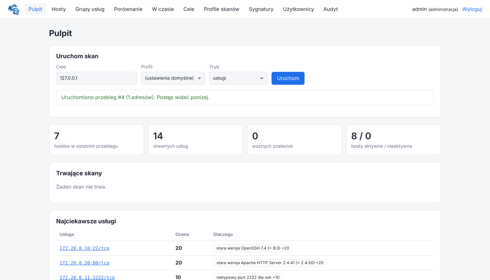
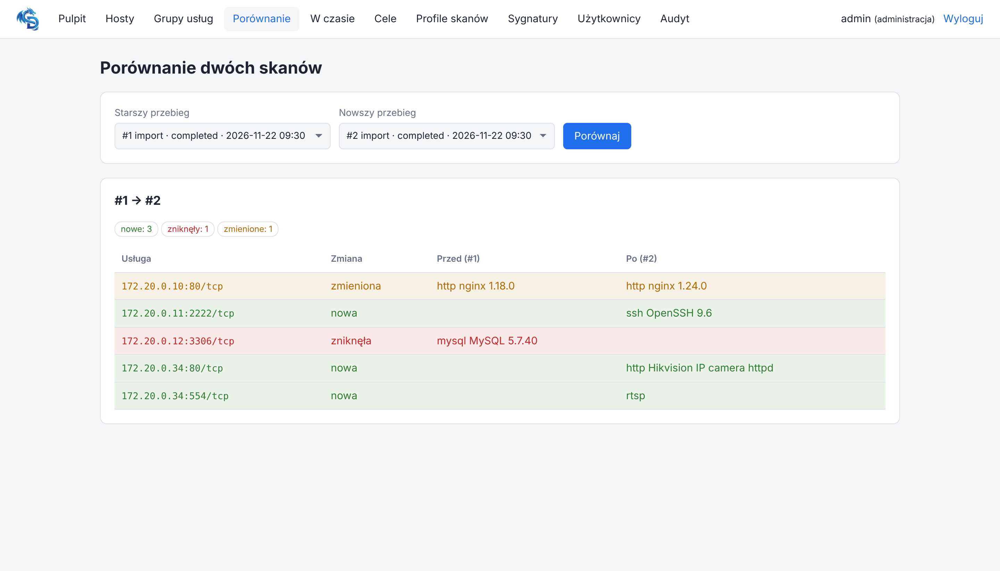
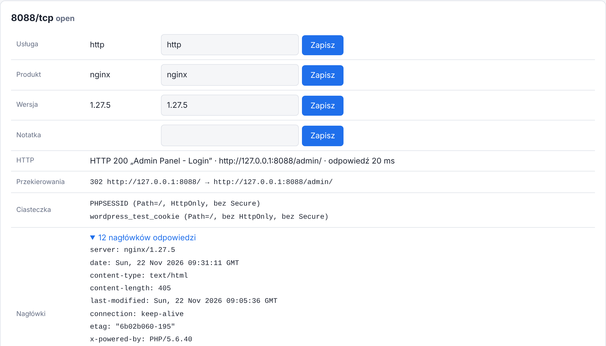
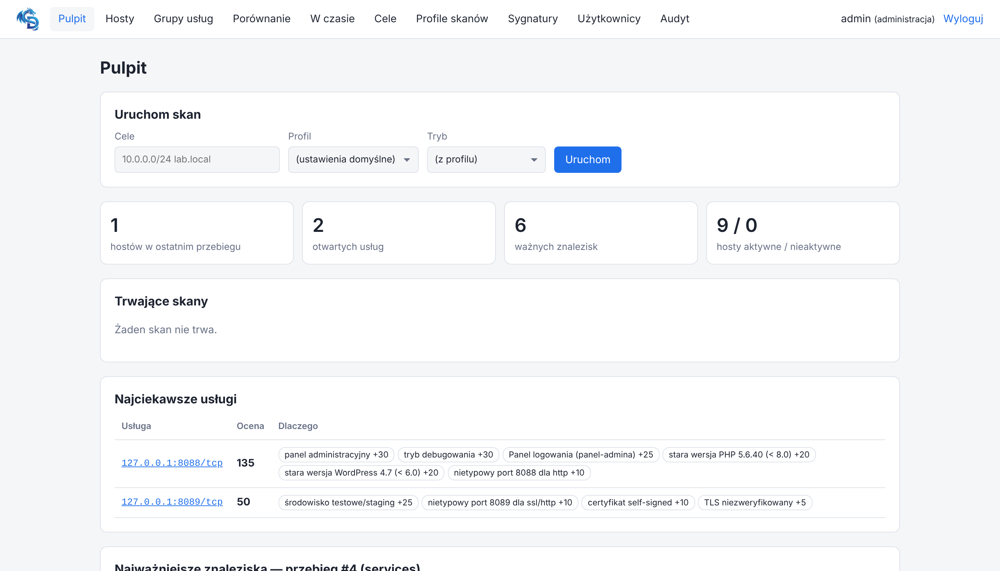
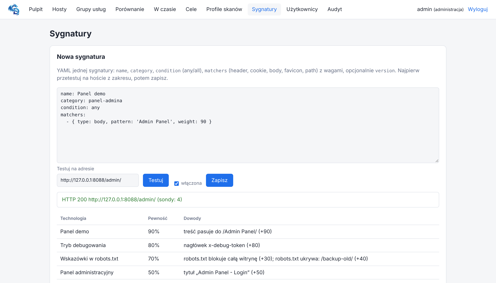
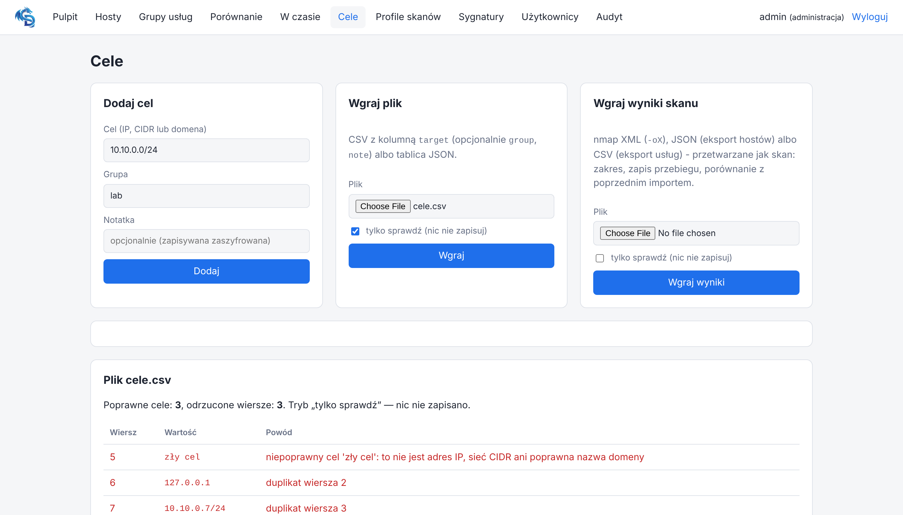
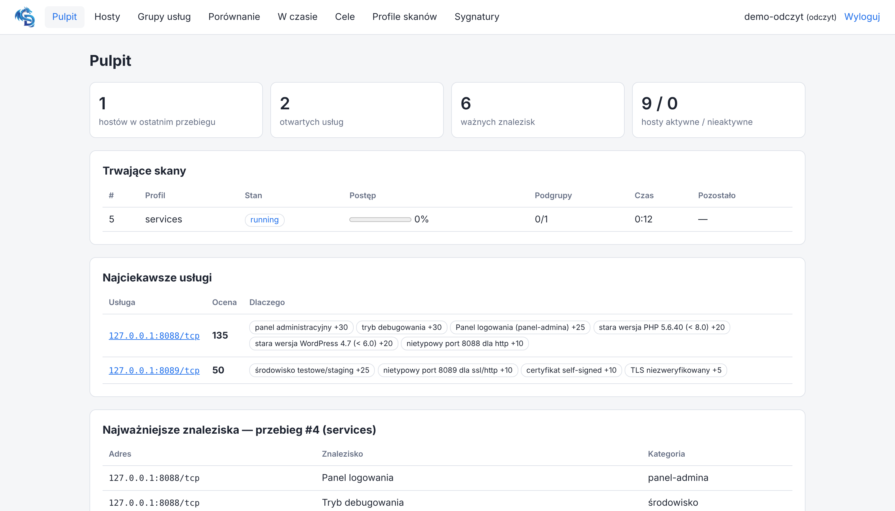
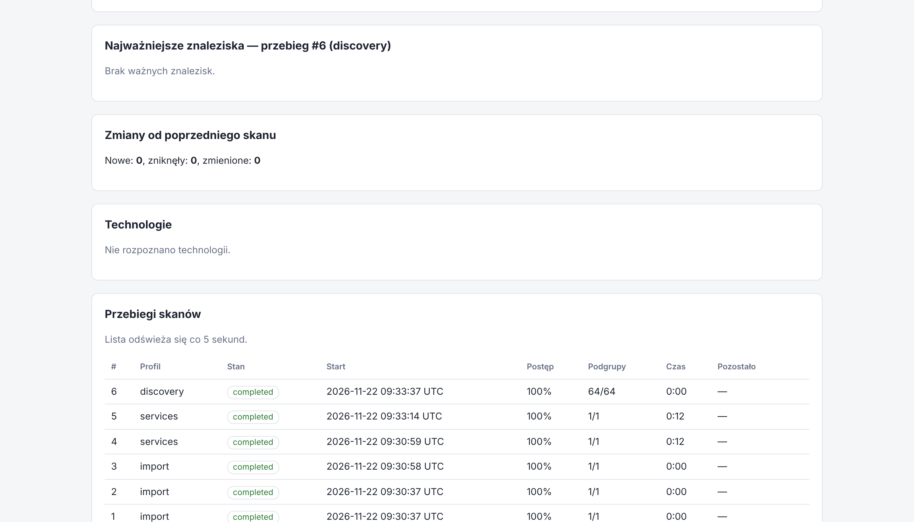

# DScan - Defect Scan

Attack Surface Intelligence: cykliczne skanowanie rozległych sieci z wykrywaniem zmian

- jedna binarka w Ruście: serwer WWW + API + CLI, PostgreSQL
- instalacja: `./install.sh`, uruchomienie: `./run.sh`

---

## Wyzwanie → DScan

- **1-4** cele IP/CIDR/domeny, bezpieczny skan nmap w podgrupach, hosty i usługi
- **5-7** HTTP/HTTPS: tytuł, kod, nagłówki, ciasteczka, TLS, przekierowania; CMS, IoT, staging, panele
- **8-10** porównanie przebiegów, usługi nowe / zniknięte / zmienione, własne sygnatury
- **11-14** formularz ręczny i CSV/JSON, RBAC z 4 rolami, trwała edycja wyników
- **15-16** dashboard znalezisk, szyfrowanie danych wrażliwych AES-256-GCM

---

## Wymagania 1-4: skan discovery z panelu

Cele, profil i tryb w formularzu · wielowątkowy nmap · postęp, czas trwania i prognoza

---

## Wymagania 8-9: porównanie przebiegów

Usługi nowe, zniknięte i zmienione między dowolnymi skanami (np. nginx 1.18.0 → 1.24.0)

---

## Wymagania 5-7: fingerprinting HTTP/HTTPS

Przekierowania, ciasteczka z atrybutami, nagłówki · WordPress, PHP, panel logowania, tryb debugowania

---

## Wymaganie 15: dashboard najważniejszych znalezisk

Ranking „ciekawości” z uzasadnieniem: panel, debug, stare wersje, staging, certyfikat self-signed

---

## Wymaganie 10: własne sygnatury

Edytor YAML z testem na usłudze przed zapisem · nagłówek, ciasteczko, treść, favicon, ścieżka

---

## Wymagania 11 i 14: formularz, import, edycja

Wpis ręczny i pliki CSV/JSON z raportem odrzuconych wierszy · import wyników nmap · edycja trwała między skanami

---

## Wymagania 12, 13, 16: role i ochrona danych

4 role + własne, rola „odczyt” bez formularzy zmian, dziennik audytu · dane poufne szyfrowane, wartości ciasteczek ukryte

---

## Ponad 10 000 adresów i bezpieczeństwo skanera

16 384 adresów w 64 podgrupach · tylko dozwolone sieci i porty, limit tempa, bez NSE i prób logowania

